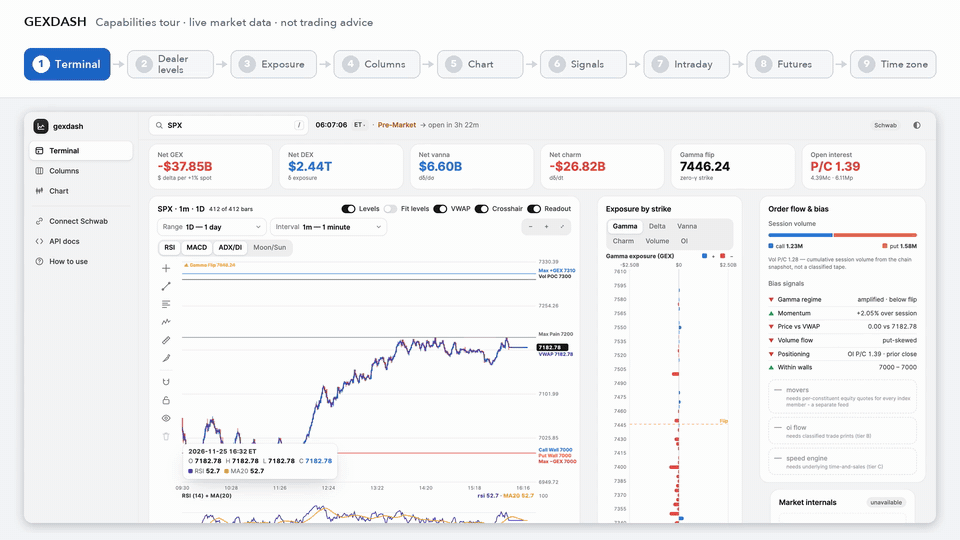
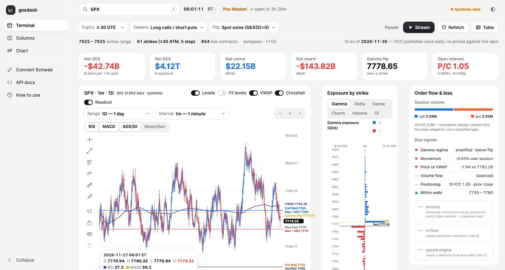
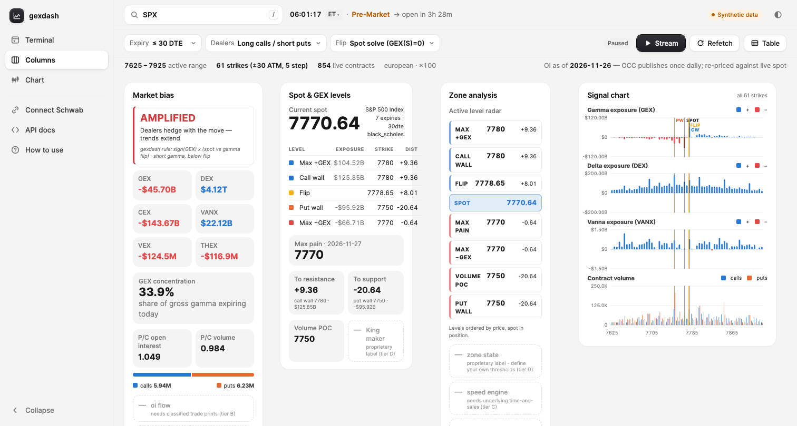
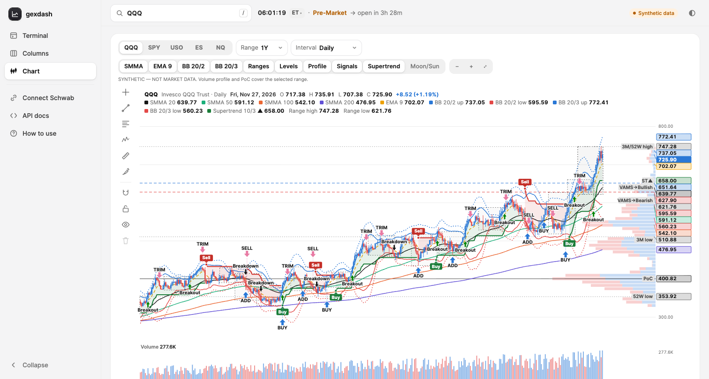

# GEXDASH

**Options dealer exposure and trend signals in one open-source dashboard.**

GEXDASH estimates where options dealers have to hedge, for **SPX, SPY, ES, NDX,
QQQ, NQ and USO**: GEX, DEX, VANX, CEX, VEX and THEX by strike, the call and
put walls, the gamma flip, max pain and volume POC, re-priced against live spot
on every tick. Beside it, a technical chart for **any ticker** (QQQ, SPY, USO,
ES and NQ are one click away) draws averages, Bollinger bands, Supertrend, a volume profile and written-rule
signals, from 1-minute to weekly bars. It runs on your own Schwab data, or on
synthetic data with no account at all.



**[Watch the narrated tour](docs/media/gexdash-tour.mp4)** (3:04, live data,
[subtitles](docs/media/gexdash-tour.srt)) · **[How to use it](docs/how-to-use.md)**
(install, connect Schwab, every screen explained)

## Quick start

```bash
git clone https://github.com/atminskymoment/gexdash.git
cd gexdash
pip install -e .                  # Python 3.11+
python -m gexdash.server          # http://127.0.0.1:8420
```

Runs immediately with a synthetic provider — no credentials, no market hours.
The banner says `SYNTHETIC — NOT MARKET DATA` when it is not real. For live
data, [connect Schwab](docs/how-to-use.md#2-connect-schwab-for-live-data): it is
free with a brokerage account.

> **Not investment advice.** GEXDASH is an analysis tool built on stated
> assumptions. The biggest of them, who holds which side of each option, is a
> guess about positioning nobody publishes. [Why that matters](docs/methodology.md#4-the-dealer-sign-convention).

## Three views

| Terminal | Columns | Chart |
|---|---|---|
| [](docs/images/terminal.png) | [](docs/images/columns.png) | [](docs/images/chart-daily.png) |

Switch in the sidebar, or link directly with `?view=`. The page follows the
[AffectUI](https://www.affectui.com/components) design system, recreated in
plain CSS: a sidebar for the views, a slim top bar with one search for the
symbol on screen (`/` focuses it), and one toolbar row for the exposure
settings.

*Screenshots use the synthetic provider, so the prices are invented.*

| View | Shape | Use |
|---|---|---|
| **Terminal** *(default)* | KPI strip, candlestick chart with GEX levels overlaid, tabbed exposure-by-strike, order flow & bias | Watching one instrument through the session |
| **Columns** | Market bias / spot & levels / zone analysis / signal chart, four panels | Reading the whole exposure surface at once |
| **Chart** | Full-width chart, 1-minute to weekly: SMMA 20/50/100/200, EMA 9, Bollinger 20/2 + 20/3, Supertrend, volume + volume profile, RSI, MACD, VAMS ribbons, ranges and signals | Reading trend and position for QQQ, SPY, USO, ES, NQ |

**Any ticker.** Type a symbol into the top bar's search, on any view: `AAPL`, `BRK.B`, `$RUT`, `/CL`. The seven above carry verified
specs. Anything else is priced on stated generic ones: an equity or ETF at
×100, American exercise, no dividend unless `div` is passed; a `$` cash index
European. A typed future such as `/CL` gets charts, unadjusted for rolls, but
no exposure: its contract multiplier is unknown, and a guessed one would be a
pure scale error. See [data sources](docs/data-sources.md#typed-symbols).

**Drawing.** Both price charts carry a drawing toolbar on the left. Drawings
are stored by time and price per symbol in this browser, shared between the
two charts, and survive zoom, refresh and changes of view or bar size. A
point outside the loaded bars is placed by the calendar (weekdays, holidays
not modelled; intraday by the bar size, with no session calendar), so there
it is approximate. See [below](#drawing-tools).

Both price charts, Terminal and Chart, also take a **Moon/Sun** toggle: the
lunar-solar cycle with its 1st and 2nd derivatives, drawn past the last bar
into future dates, a dotted projected path with its highs and lows labelled,
and the new and full moons, perigees, equinoxes and solstices. See
[below](#the-lunar-solar-cycle). The Columns signal chart is plotted by strike,
not by time, so the toggle does not apply to it.

Terminal and Columns render the same `/api/exposure` payload and share their
chart primitives, so the two cannot disagree. Chart reads only
`/api/technicals` and has its own symbol tabs, so it works for USO, and with no
option chain loaded at all. The terminal view additionally uses
`/api/history` for candles and `/api/breadth` for market internals. Both are
**optional** capabilities: a provider that cannot serve them gets a stated
reason where the panel would be, and everything else is unaffected.

---

## The constraint everything is built around

**Open interest updates once per day.** The OCC computes OI after the close
and publishes it before the next open. There is no live OI feed — not from any
vendor at any price. Every "live GEX" number on every dashboard, commercial
ones included, is last night's OI re-priced against current spot.

That is good news and bad news:

- **Good:** most of a GEX dashboard still works, because gamma and delta are
  functions of spot. A frozen OI snapshot re-prices continuously as price moves.
- **Bad:** everything derived from *flow* is an estimate you would have to build.

So the chain is fetched **once a day** and spot **streams**. That split is the
whole architecture. Metrics needing a live trade feed are rendered as explicit
placeholders with the reason — never as a plausible-looking number.

| Tile | Status |
|---|---|
| GEX / DEX / VANX / CEX / VEX / THEX, walls, flip, max pain, volume POC, level radar | computed |
| Candles, VWAP, momentum, price-vs-VWAP | computed **when the provider serves bars** |
| OI flow, volume bias, intraday OI change | needs classified trade prints (tier B) |
| Speed engine | needs underlying time-and-sales (tier C) |
| Kinetics, dealer regime, zone state, king maker | proprietary labels — define your own (tier D) |
| Market internals — advancing/declining, A/D ratio, TICK, TRIN, session A/D line | computed from the **exchange breadth symbols** (`$ADVN`/`$DECN`) |
| Candles 1m–monthly over 1 day–10 years, zoom/pan, crosshair, RSI+MA(20) · MACD · ADX/DI | computed; **sub-minute bars need a tick feed** and are refused with that reason |
| Written reading — what the current GEX/DEX/vanna/charm and levels imply, together | computed by a fixed rule set; **withheld** when there is no open interest to read |
| Top gainers / losers | needs per-constituent quotes for every index member — a separate feed |
| Chart view: SMMA 20/50/100/200, EMA 9, Bollinger 20/2 + 20/3, RSI 14, MACD 12/26/9, volume profile + PoC, 3M/52W levels | computed over the feed's **full history** and then trimmed, so SMMA 200 is converged at the left edge |
| Chart view: VAMS state, range breakouts, BUY / ADD / TRIM / SELL | **gexdash's own written rules**, shown under the chart. They are not the private script the reference chart uses |
| Chart view: earnings (`E`) markers | not drawn: ETFs and index futures do not report earnings |
| Sun and Moon positions; new, quarter and full moons, perigee and apogee, equinoxes and solstices | computed from a Meeus ephemeris, past and future, no data files; phases within 2 minutes of PyEphem |
| Lunar-solar cycle (LSC), its 1st and 2nd derivative, projected path with High/Low dates | **gexdash's own model**, fitted to the symbol's daily returns and tested on a holdout it was not fitted to. It is not the reference chart's PPM2 script, and the projection has not shown skill unless its holdout says so |

---

## Instruments

| Key | Instrument | Multiplier | Model | Exercise |
|---|---|---|---|---|
| `SPX` | S&P 500 Index | ×100 | Black-Scholes | European |
| `SPY` | SPDR S&P 500 ETF | ×100 | Black-Scholes | **American** ¹ |
| `ES` | E-mini S&P 500 future | ×$50 | Black-76 | **American** ² ³ |
| `NDX` | Nasdaq-100 Index | ×100 | Black-Scholes | European |
| `QQQ` | Invesco QQQ Trust | ×100 | Black-Scholes | **American** ¹ |
| `NQ` | E-mini Nasdaq-100 future | ×$20 | Black-76 | **American** ² ³ |
| `USO` | United States Oil Fund | ×100 | Black-Scholes | **American** ¹ |

All American instruments keep European greeks and **disclose** it; the error is
**measured, not assumed**, and it differs structurally between the two cases:

| | worst delta error, ±5% | at ±10% / 60 DTE | worst case sits in |
|---|---|---|---|
| ¹ ETFs (q < r) | 0.018 | 0.050 | always an **ITM put** |
| ² Futures (q = r) | 0.004 | 0.012 | usually an **ITM call**; premium is near-symmetric |

See [methodology §7](docs/methodology.md#7-american-exercise).

² CME quarterly and serial options on E-mini futures are American-style; the
weeklies and EOM are European. The family is labelled by its quarterlies.
Override per instrument without editing code:
`GEXDASH_EXERCISE_OVERRIDES="NQ=european"`.

³ **ES and NQ exposure does not work on Schwab.** The maths is implemented and
tested, but only against the mock provider. Schwab's `/chains` answers `400`
for `/ES` and `/NQ` (checked 2026-11-23). Their price history does load: a
series whose last price fails the instrument's plausibility band is refused,
because bare `ES` is Eversource Energy, and one that passes is drawn with an
"unverified" note. It is the front month. Both charts adjust it for
contract changes by default, as thinkorswim's option of that name does. See
[data sources](docs/data-sources.md).

---

## Documentation

| Document | Contents |
|---|---|
| [docs/how-to-use.md](docs/how-to-use.md) | **Start here.** Install, connect Schwab, and every screen explained with annotated screenshots |
| [docs/api.md](docs/api.md) | HTTP endpoints, parameters, response schema, status codes |
| [docs/methodology.md](docs/methodology.md) | Every formula and assumption: greeks, exposure units, sign conventions, flip methods, American approximation |
| [docs/data-sources.md](docs/data-sources.md) | Providers, Schwab setup, OPRA fees, instrument reference |
| [docs/architecture.md](docs/architecture.md) | Module map, design decisions, test strategy |
| [TODO.md](TODO.md) | Known bugs not yet fixed, most visible first |

Interactive OpenAPI docs are served at `/api/docs` when running.

---

## Modelling choices that move the numbers

All exposed as parameters, all reported in the UI's provenance panel. None are
hidden constants.

**Expiry window.** "Total GEX" is meaningless until you say across which
expiries; this moves the result more than anything else. Default `≤ 30 DTE`.

**Dealer sign convention.** Nobody publishes dealer inventory. The
near-universal convention — dealers long calls, short puts — is an
*assumption*, and it moves the gamma flip more than any data-quality issue.

> One consequence worth knowing: that convention is designed for *gamma*,
> which is positive for calls and puts alike and so needs an external sign.
> Applied uniformly it also implies dealers are long every call and short every
> put — a synthetic long against the whole chain — so aggregate DEX comes out
> very large and positive by construction. For the conventional netted dollar
> delta, use `all_long`. On a typical SPX chain that is +$4.2T vs −$45B.

**Gamma flip method.** Two defensible definitions that do not agree:
`spot_solve` (default) root-finds over spot for total GEX = 0, re-pricing every
contract's gamma; `cumulative` finds where the running sum by strike crosses
zero. The first is what people mean by "below the flip, dealers are short
gamma"; the second is cheaper but ignores that gamma moves with spot.

**Rate and dividend yield.** These feed vanna and charm, which no provider
publishes and nothing downstream can check. Each instrument carries its own
dividend default — applying the S&P's 1.3% to QQQ would be wrong.

---

## When the feed misbehaves

Bad data that looks like good data is the failure mode this project spends the
most effort on. Two cases are handled explicitly rather than displayed.

**A chain with no open interest.** Observed live: 16,862 SPX contracts with OI
on 2 of them, volume populated, no error. Every exposure measure is
proportional to OI, so the surface reads `$0` — a confident number, not a gap.
Detected by OI *coverage* (healthy chains run 34–73% of contracts; that one was
0.01%), never cached over a good snapshot, and the last usable chain is served
instead with the reason stated. With nothing to fall back on, the tiles read
`n/a` and the written reading is withheld entirely. Retries back off
30s → 60s → 120s → 240s → 480s; ↻ refetch bypasses it.

**A range that cannot be served exactly.** A year of 1-minute bars exists
nowhere. Rather than quietly substituting, the request is adjusted and the
adjustment is reported: the bar size coarsens and says so, and sub-minute
intervals are refused outright with the reason. Combinations that cannot be
served are greyed out in the selector rather than accepted and silently
changed. Requests are bounded by explicit dates, so the range asked for is the
range served — nothing is rounded up to a period bucket.

---

## Verifying the greeks

Vanna and charm are self-computed and unverifiable downstream: a wrong rate
produces a smooth, plausible, wrong VANX. Two defences:

**Finite differences.** Every analytic partial is pinned against a numerical
derivative of the price function — that is what catches sign errors.

**Provider cross-check.** Schwab publishes delta and gamma, and all six greeks
come from the same call with the same `r` and `q`:

```bash
python -m gexdash.crosscheck --symbol SPX --provider schwab --fit-rate
```

A delta MAE above ~0.01 means the rate or dividend assumption is off.
`--fit-rate` solves for the rate that best reproduces the provider's deltas —
if that lands far from what you configured, what you configured is wrong.

---

## Charting notes

Two deliberate departures from the commercial dashboard this layout is
modelled on:

- **No dual axes.** The reference stacks two measures with different scales on
  one plot. Two y-scales align arbitrarily, which invents a correlation the
  data does not contain. Each measure here is its own small multiple over a
  shared strike axis.
- **Calls/puts are blue/orange, not green/red.** Green-vs-red is the worst pair
  under colour-vision deficiency, and this is the one distinction that must
  never be ambiguous.

Both palettes were validated against the surface they render on — all six
checks pass in light and dark (worst adjacent CVD ΔE 21.6–26.8, target ≥ 8).
Light is the default; dark is opt-in via the toggle, `?theme=dark`, or the OS
setting.

**Time zone.** Every time on screen follows the zone tag beside the top bar's
clock: the clock, intraday axis ticks, crosshair tags, legends, readouts and
signal tooltips, in both the Terminal and Chart views. The tag is the picker.
It offers New York (exchange time, the default), your machine's own zone, and
the main market centres, and `?tz=Asia/Tokyo` links any IANA zone. Display
only: sessions stay the exchange's, so 1h bars still start at 9:30 ET, and
daily bars keep their session date in every zone. An intraday session label
names its trading day, so in Tokyo a bar from Monday's US session reads
Tuesday morning under a "Mon" divider.

### The price panel

Ranges `1D`–`10Y` against intervals `1m`–`1Mo`, zoom and pan, and the dealer
levels — call/put wall, gamma flip, max pain, max ±GEX, volume POC — drawn as
price lines. A level outside the visible range is pinned to the edge with a
direction arrow rather than dropped, because "indicate the walls" has to hold
when a wall is far away.

Below it, RSI with a 20-period MA, MACD, and ADX/DI — computed server-side in
`indicators.py` so they can be tested. Wilder's smoothing is `alpha = 1/n`,
not the `2/(n+1)` of a same-length EMA; substituting one for the other is the
classic way RSI and ADX come out subtly and permanently wrong.

Three details that are deliberate rather than incidental:

- **Ten empty bar slots to the right of the last candle.** The current bar is
  the one you look at most, and pinning it against the axis leaves nowhere for
  its tag and no room to read where price is heading.
- **Two separate limits decide which intervals a range offers.** How far back
  the feed serves that bar size (~48 days for 1-minute, ~260 for 5-minute and
  coarser), and how many candles are worth drawing. Both were measured, both
  are in `/api/meta`, and the selector greys out anything that would trip
  either — so a 6-month chart offers 15-minute bars and up, and asking for
  1-minute over a month gets 5-minute bars with a note rather than a 2-second
  render of 27,000 candles.
- **The crosshair survives a refresh.** Re-rendering rebuilds the SVG, and a
  naive implementation drops the crosshair until the pointer next moves — so
  while streaming it blinks out every few seconds under a stationary cursor.
- **Indicator warm-up is `null`, never `0`.** RSI does not exist for its first
  14 bars. The line breaks; it does not travel along the axis.

The bottom-left readout follows the cursor with the hovered bar's OHLC and
RSI, and falls back to the most recent bar when the pointer is away.

### The Chart view

A full-width chart for any ticker, with tabs for QQQ, SPY, USO, ES and NQ, in 1-, 5-, 15- and 30-minute,
hourly, 4-hour, daily or weekly bars, with
`?view=chart&chart=USO&chart_range=2Y&chart_interval=1W` to link one. Each
layer toggles: averages, EMA, both Bollinger bands, ranges, levels, profile,
signals, Supertrend.

Intraday follows TradingView's default sessions: ETFs in regular hours (the
**Ext hours** button adds pre- and post-market), ES and NQ over the full
electronic session. Hourly and 4-hour bars are anchored to the session open
(9:30, 10:30 … ET for ETFs; 18:00, 22:00 … ET for futures), and 1D/5D/10D count
sessions, so 1D on a Monday morning is Friday's session. Each bar size offers
the ranges it can reach and draw: 1-minute up to 5 days, 4-hour up to 6
months. Intraday history is shorter than daily, so each bar size fetches
its longest range plus about 1,000 bars of warm-up. Where SMMA 200 still
had too little history at the left edge (4-hour bars), the chart says so.
The 3M/52W levels come from daily bars on every bar size. Intraday charts
refresh every 30 seconds.

ES and NQ are **adjusted for contract changes** by default, as thinkorswim's
option of that name does. Before each quarterly roll (the Monday of expiry
week), prices are shifted so the last close meets the first open after it.
**Adjust rolls** turns it off, and a small `roll` mark sits at the bottom of
the price pane at each change. The roll date is verified against the index
from December 2022. Before that the step was too small to locate, and the
note counts how many of the rolls shown fall in that period. The legend and every pane title follow the cursor; the legend has a
strip of its own above the plot, so it never covers a candle. The wheel zooms
over the price pane only, so the page still scrolls over the panes below it.
Signal markers that would collide move up to two slots away from their bar,
with a dotted leader back to it. Where even that is crowded, as on a 5-year
daily chart, a marker drops its label and the label moves to its tooltip.

Indicators are standard and computed exactly. SMMA is Wilder smoothing, not an
SMA or EMA of the same length, and Bollinger uses the population standard
deviation, as Bollinger defined it. The sample form widens a 20-bar band by
about 2.6%. The signal layer is a set of stated rules:

| Mark | Rule |
|---|---|
| VAMS check | close vs SMMA 20 ± 0.5 × ATR 14: above → bullish, below → bearish, between → no call |
| VAMS state | latches the last call; decays to neutral after 5 no-call bars. `VAMS→Bullish`/`→Bearish` are the current triggers |
| Range / Breakout / Breakdown | prior 20-bar high/low; a base when its span ≤ 5 × ATR; a close outside a base is a break |
| BUY | from flat: VAMS bullish, close above SMMA 50 and SMMA 200 |
| ADD | while long: low tests SMMA 50 and the close holds above it; ≥ 10 bars apart |
| TRIM | while long: RSI 14 crosses back down through 70; ≥ 10 bars apart |
| SELL | while long: VAMS bearish and close below SMMA 50 |
| Supertrend Buy / Sell | **not a gexdash rule**: a line-for-line port of TradingView's "Supertrend" v4 script (ATR 10, multiplier 3, Wilder ATR). Bands at hl2 ∓ 3 × ATR, ratcheting while the previous close holds them; the trend flips when the close crosses the *previous* bar's opposite band |

`/api/technicals?st_period=…&st_mult=…` matches non-default Supertrend inputs.
All of these thresholds are in `technicals.TechParams` and are echoed in the
payload. If you have the source of the script you are replicating, replace the
rules there. Nothing else depends on them.

### Drawing tools

The toolbar to the left of both price charts:

| Group | Tools |
|---|---|
| Cursors | Cross, Dot, Arrow (crosshair lines hidden), Eraser |
| Lines, channels, pitchforks | Trend line, Ray, Extended line, Info line, Horizontal line and ray, Vertical line, Cross line, Parallel channel, Regression trend (±2σ), Pitchfork, Schiff and Modified Schiff pitchforks |
| Fibonacci and Gann | Fib retracement, Trend-based fib extension, Fib channel, Fib time zone, Fib speed resistance fan, Fib circles, Gann box, Gann square, Gann fan |
| Patterns, Elliott waves, cycles | XABCD and ABCD (with their ratios), Triangle pattern, Head and shoulders, Elliott impulse (1-5), correction (A-B-C), triangle (A-E), double (W-X-Y) and triple (W-X-Y-X-Z) combos, Cyclic lines, Time cycles, Sine line |
| Forecasting, volume, measures | Long and Short position (reward, risk, R/R), Forecast, Anchored VWAP, Fixed range volume profile (POC, 70% value area), Price range, Date range, Date and price range |
| Brushes, arrows, shapes | Brush, Highlighter, Arrow, Arrow marks up and down, Rectangle, Circle, Ellipse, Triangle, Path, Curve |
| Then | Magnet (snap to the bar's open, high, low or close), **Lock all**, **Hide all**, Remove (the selected drawing, or all of the symbol's with a second click) |

Click to place each point; a press, drag and release places two at once. The
Path tool finishes on a double-click or Enter. After placing a drawing the
pointer returns to the cursor you last chose. Click a drawing to select it,
drag a point or the body to move it, and press Delete to remove it; Escape
cancels or deselects. Points snap to bars; past the last bar they snap to
future dates on the same rule as the Moon/Sun layer, so a drawing there
lands on the same date with that layer on or off. Every measure a drawing
shows (Fibonacci prices, pitchfork medians, Gann slopes, the regression
channel, VWAP, volume profile, reward and risk) is computed in
`static/draw.js` and tested under Node. Definitions that differ between
platforms are in each tool's tooltip and in [how to use](docs/how-to-use.md#7-drawing-on-the-charts).

### The lunar-solar cycle

**Moon/Sun** is a toggle on both price charts. It is off by default and
remembered once switched on. It draws three things:

- **A pane** with the lunar-solar cycle (LSC) and its 1st and 2nd
  derivatives. They are solid over the bars and dotted past the last one,
  because past it they are computed from where the Sun and Moon will be, not
  observed. Icons along the top mark new, quarter and full moons (☉ for
  equinoxes and solstices, P and A for perigee and apogee), each with its
  time in a tooltip.
- **A projected path** on the price pane, dotted from the last close, with
  "High Dec 22" or "Low Dec 31" at each turn. Daily, weekly and monthly bars
  only.
- **The Moon in the legend:** phase, share lit, distance, declination and the
  next new or full moon. Hovering a future date shows its projected price.

The model is gexdash's own, written out under the chart beside the other
rules:

| Step | Rule |
|---|---|
| Fit | daily log returns (up to 10 years, whatever the chart's bar size) regressed, ridge 0.02 on centred features, on cos/sin of five ephemeris angles at each 16:00 ET close: lunar phase (29.53 d), its second harmonic for spring and neap tides (14.77 d), lunar distance (27.55 d), lunar declination (27.32 d), the Sun's longitude (the year). Futures fit on the raw front month, with each roll day's return left out |
| LSC | the fitted cyclical return accumulated over trading days: the part of the price the cycles explain. Over past bars it is in-sample, so it matches past turns partly by construction |
| 1st / 2nd derivative | the fitted cyclical return per trading day, and its rate of change, read at each bar's own time. Each line is scaled to its own largest swing, so all three run ±1 |
| Projection | last close × exp(change in LSC), at the **fitted** amplitude, not rescaled. A high or low is labelled where the path reverses by 5% of its range. Future dates are weekdays; holidays are not modelled |
| Holdout | fitted on the first 75% of the history, tested on the last 25%. The note gives the direction hit rate beside what calls with **no skill** would score with the same mix of up and down calls, and the correlation beside its noise band, ±2/√n |

The charts this was modelled on draw a "PPM2" line from a private script.
This is not a reconstruction of it. Read the holdout before the path. Where
its correlation sits inside the noise band, the cycles explained nothing out
of sample, and the projection is a drawing of the fit, not a forecast. On the
synthetic provider's random walk it sits inside, as it should. Thresholds are in
`cycles.AstroParams`; see [methodology §11](docs/methodology.md#11-the-lunar-solar-cycle).

---

## Layout

```
gexdash/
  bars.py         intraday OHLCV + VWAP for the terminal view's price panel
  history.py      chart range/interval vocabulary, provider mapping, aggregation
  indicators.py   RSI, MACD, ADX/DI, SMMA, Bollinger, ATR, Supertrend -- Wilder where Wilder specified it
  technicals.py   Chart view: overlays, profile, levels, VAMS + signal rules, sessions, warm-up
  astro.py        Sun and Moon ephemeris (Meeus), lunar phases, perigee/apogee, equinoxes/solstices
  cycles.py       the lunar-solar cycle: daily fit, derivatives, projection, turns, holdout test
  futures.py      contract-change roll dates and back-adjustment (thinkorswim's definition)
  breadth.py      exchange market internals from the $ADVN/$DECN symbol family
  greeks.py       vectorized Black-Scholes; Black-76 via the q = r identity
  american.py     CRR binomial — bounds the SPY/QQQ approximation error
  exposure.py     exposure surface, walls, flip, max pain, regime
  interpretation.py  the written reading -- server-side so the wording is tested
  chain.py        option chain as parallel numpy arrays
  instruments.py  per-instrument specs
  sessions.py     US exchange session dates and market phase
  store.py        SQLite chain cache, CachedProvider, degraded-feed policy
  crosscheck.py   diff our greeks against the provider's
  server.py       FastAPI + SSE
  providers/      mock (synthetic) and schwab
  static/         dashboard + ui.js + technicals.js + astro.js + draw.js + tz.js — no build step, no CDN, no chart library
docs/             how-to-use · api · methodology · data-sources · architecture
  images/         the guide's screenshots (synthetic data)
  media/          the narrated tour (MP4 + subtitles) and the README preview GIF
tests/            greeks · american · exposure · instruments · providers · crosscheck · server
                  · history · bars · technicals · futures · breadth · tz · astro · cycles · symbols · draw · ...
```

A ~2000-contract chain re-prices in well under a millisecond. A full
`/api/exposure` request measures **~33 ms** with `spot_solve` (~140 chain
re-pricings to root-find the flip) and **~3 ms** with `cumulative` —
comfortably inside the 2 s stream interval. `scipy` is not a dependency.

---

## Tests

```bash
python -m pytest tests/ -q      # 583 tests, ~16s
```

Covering finite-difference validation of all six greeks, the Black-76
identity, the American error bound, exposure levels on hand-built chains with
known answers, contract multipliers against published specs, Schwab response
parsing without network, store round-trips, cross-check sensitivity to a wrong
rate, and the full API surface including SSE and the stale-cache fallback.

A good number of them are regressions for bugs found during the build, each
invisible to the obvious test: a chart that drew a year under a "3M" label, a
chain of zeros cached over a good one, and an interpretation sentence that
called a level below spot "above" it. See
[architecture.md](docs/architecture.md#regression-tests-worth-knowing-about).

---

## Fees, briefly

Two different tapes are in play. **Options** data is OPRA; the **breadth
symbols are exchange equity data** (CTA/UTP), licensed separately with its own
personal-versus-redistribution cliff. Both are covered for personal use by a
brokerage entitlement.

OPRA subscriber fees are separate from any vendor subscription:
**$1.25/user/month** non-professional, **$31.50** professional,
**$1,500/month** the moment data is redistributed to anyone else. Personal use
rounds to zero; a product does not. Keep the data layer behind the provider
interface and do not architect around free redistribution.

---

## Licence

MIT — see [LICENSE](LICENSE).

**Not investment advice.** This is an analysis tool built on a stated set of
assumptions, several of which — above all the dealer sign convention — are
guesses about unobservable positioning.
