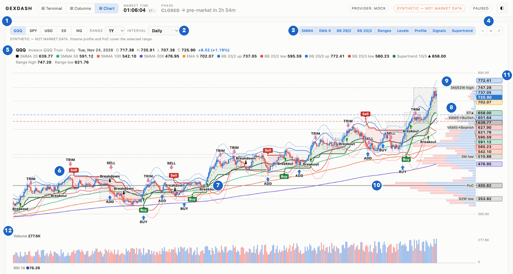
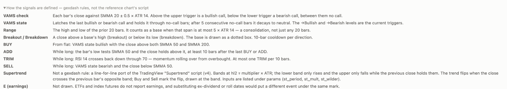
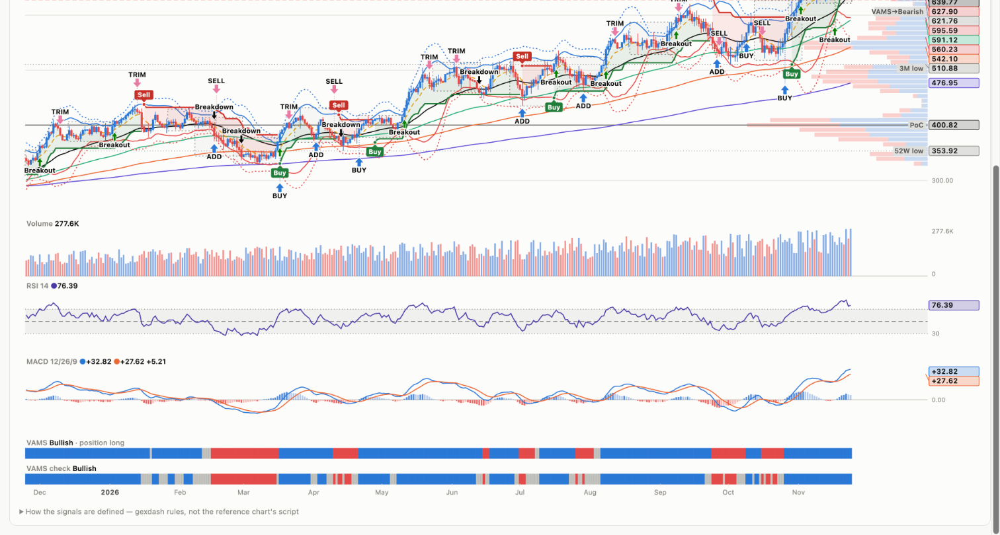
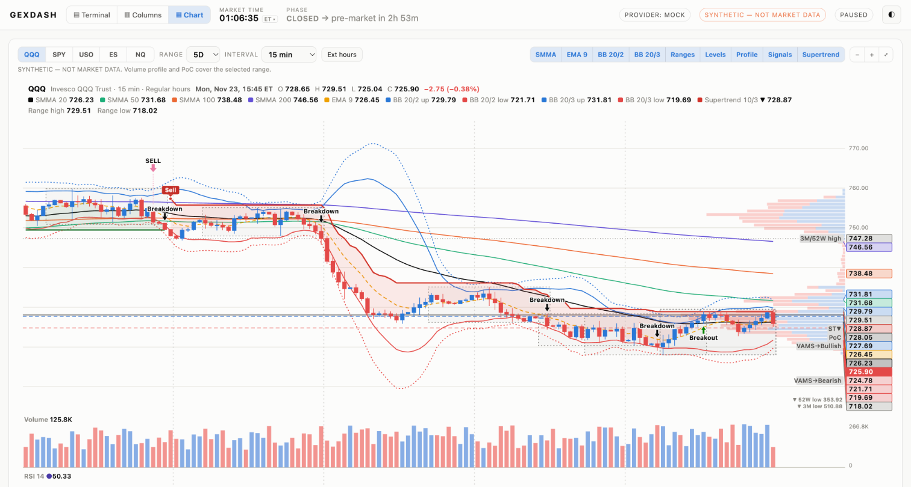
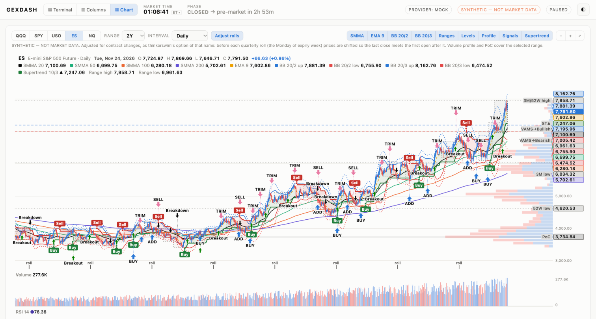
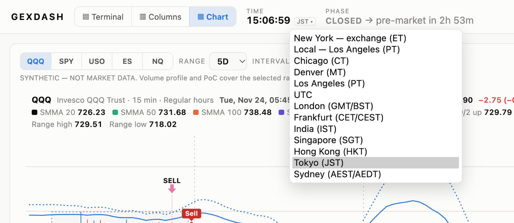
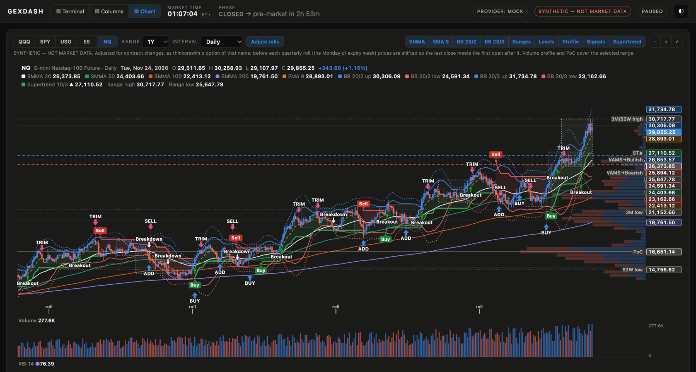

# How to use GEXDASH

GEXDASH estimates where options dealers have to hedge (gamma, delta, vanna and
charm exposure by strike, the walls and the gamma flip) and charts trend and
signals beside it. This guide walks through installing it, connecting live
data, and reading every screen.


**Watch the narrated tour:** [gexdash-tour.mp4](media/gexdash-tour.mp4)
(2:51, with [subtitles](media/gexdash-tour.srt)). The video and the preview
above use live market data; the screenshots below use the built-in synthetic
data, so their prices are invented.

> **Not trading advice.** GEXDASH is an analysis tool. Every exposure figure
> rests on an assumption about who holds each side of the trade, which nobody
> publishes. See [the dealer sign convention](methodology.md#4-the-dealer-sign-convention).

## Contents

1. [Install and start](#1-install-and-start)
2. [Connect Schwab for live data](#2-connect-schwab-for-live-data)
3. [The header](#3-the-header)
4. [Terminal view](#4-terminal-view)
5. [Columns view](#5-columns-view)
6. [Chart view](#6-chart-view)
7. [Time zone](#7-time-zone)
8. [Light and dark](#8-light-and-dark)
9. [Links you can share](#9-links-you-can-share)
10. [Troubleshooting](#10-troubleshooting)

---

## 1. Install and start

You need Python 3.11 or newer. Nothing else: no Node, no database server, no
build step.

```bash
git clone https://github.com/atminskymoment/gexdash.git
cd gexdash
python -m venv .venv
source .venv/bin/activate          # Windows: .venv\Scripts\activate
pip install -e .
python -m gexdash.server           # or just: gexdash
```

Open <http://127.0.0.1:8420>. It starts on **synthetic data**, with no account
and at any hour, so you can explore everything first. While it is synthetic,
the header carries a `SYNTHETIC — NOT MARKET DATA` badge and every chart says
so too.

To use a different address or port, set `GEXDASH_HOST` or `GEXDASH_PORT`
(see [`.env.example`](../.env.example)).

## 2. Connect Schwab for live data

Schwab's API is free with a brokerage account and carries the same data as
thinkorswim.

1. Register an app at [developer.schwab.com](https://developer.schwab.com)
   (Market Data Production). Set its callback URL to
   `https://127.0.0.1:8182`. It must be `https`.
2. Copy `.env.example` to `.env` and fill in your keys:

   ```bash
   SCHWAB_APP_KEY=...
   SCHWAB_APP_SECRET=...
   SCHWAB_CALLBACK_URL=https://127.0.0.1:8182
   GEXDASH_PROVIDER=schwab
   ```

   `.env` is git-ignored. Never commit it.
3. Restart the server and open <http://127.0.0.1:8420/connect>.


4. **Authorize with Schwab** opens Schwab in a new tab. After you approve,
   the browser tries to load the callback and *fails to connect*. That is
   expected: the address bar still holds the code.
5. Copy that whole address, paste it into step 2 on the page, and press
   **Connect**. Do it straight away; the code is short-lived.

The access token refreshes itself. The **refresh token lasts 7 days**, and
Schwab offers no way around re-consenting. Two days before it expires, the
dashboard shows a *Reconnect* notice; follow it and repeat steps 4 and 5.
From a terminal, `python -m gexdash.providers.schwab login` does the same.

**What works on Schwab:** exposure for SPX, SPY, NDX, QQQ and USO, and charts
for all five chart symbols. Schwab's option-chain API refuses the ES and NQ
futures, so their *exposure* is unavailable; their *charts* work. Details are
in [data sources](data-sources.md#schwab--free-and-the-recommended-start).

## 3. The header

The header is the same in every view.

| Part | What it does |
|---|---|
| **Terminal · Columns · Chart** | Switches the view. Your choice is remembered. |
| **Clock and zone tag** | The time in the zone you pick (New York by default). The tag beside it is the [zone picker](#7-time-zone). |
| **Phase** | Pre-market, open, after-hours or closed, and the time to the next change, on the exchange's clock. |
| **Provider badge** | `mock` (synthetic) or `schwab`. |
| **Paused / streaming** | Whether the exposure surface is live-streaming. |
| **Ticker** | The instrument for the Terminal and Columns views: SPX, SPY, ES, NDX, QQQ, NQ or USO. |
| **◐** | Light or dark. |

## 4. Terminal view

One instrument through the session: exposure across the top, candles with
the dealer levels in the middle, exposure by strike beside them.


1. **View switch.**
2. **Clock and time-zone picker.**
3. **Ticker.**
4. **Filters.** These change every number on the page:
   - *Expiry window* (0DTE, ≤ 7, ≤ 30, ≤ 60 DTE, or all listed): which
     expiries count. It moves the result more than anything else; the
     default is ≤ 30 DTE.
   - *Dealer assumption*: who holds which side. The default, *long calls /
     short puts*, is the common convention and an assumption. *Raw netted*
     applies no sign flip.
   - *Flip method*: *Spot solve* finds the spot price where total gamma
     exposure crosses zero, re-pricing every contract; *Cumulative by
     strike* finds where the running sum by strike crosses zero.
5. **Stream, refetch, table.** *▶ start* streams the surface every 2 seconds.
   *↻ refetch* pulls a fresh option chain now. *▤ table* opens the per-strike
   table.
6. **Exposure tiles.** Net GEX (dollar delta per +1% move in spot), net DEX,
   vanna, charm, the gamma flip, and put/call open interest.
7. **Range and interval** of the candles, from 1 day to 10 years and 1-minute
   to monthly. Combinations that can't be served are greyed out.
8. **Layers.** *Levels* draws the dealer levels; *Fit levels* stretches the
   price scale to include every level, even far ones; *VWAP*, *Crosshair* and
   *Readout* toggle what they say. RSI, MACD and ADX/DI toggle the panes
   underneath.
9. **Dealer levels** on the price chart: call wall, put wall, gamma flip, max
   pain, the largest positive and negative gamma strikes, and the volume
   point of control. A level outside the visible range is pinned to the edge
   with an arrow rather than dropped.
10. **Readout.** The bar under the cursor (or the latest bar): open, high,
    low, close, RSI and its 20-bar average.
11. **Exposure by strike.** Gamma, delta, vanna, charm, volume and open
    interest, one tab each, with the flip and spot marked.
12. **Order flow and bias.** Session volume split by calls and puts, and bias
    signals: gamma regime, momentum, price against VWAP, volume flow,
    positioning, and whether price sits between the walls. Market internals
    (advancing and declining issues, TICK, TRIN, a session A/D line) sit
    below.

Hover the price chart for the crosshair and readout. Scroll over it to zoom,
drag to pan, and use **−**, **+** and **⤢** (fit) above it.


Below the chart, a **written reading** puts the current exposure and levels
into words, for example "Dealers hedge with the move — trends extend". It is
produced by a fixed rule set, and it is withheld when the chain carries no
open interest to read.

Tiles that need data this tool doesn't have (classified trade prints,
time-and-sales, per-constituent quotes) are shown greyed with the reason,
never as a plausible-looking number.

## 5. Columns view

The same exposure data as the Terminal, laid out to read the whole surface at
once: market bias, spot and levels, the active level radar (every level in
price order with spot in position), and exposure by strike as small multiples.


The **Model and data provenance** panel at the bottom records every
assumption behind the numbers: expiry window, dealer assumption, flip method,
pricing model, rate and dividend, and when open interest was published.

## 6. Chart view

A full-width technical chart for **QQQ, SPY, USO, ES and NQ**. It doesn't use
the option chain, so it works for any of the five whatever the ticker in the
header.



1. **Symbols.**
2. **Range and bar size.** Each bar size offers the ranges it can reach:

   | Bar size | Ranges |
   |---|---|
   | 1 min | 1D, 5D |
   | 5 min | 1D, 5D, 10D, 1M |
   | 15 min | 1D, 5D, 10D, 1M, 3M |
   | 30 min, 1 hour | 5D, 10D, 1M, 3M, 6M |
   | 4 hours | 1M, 3M, 6M |
   | Daily | 3M, 6M, YTD, 1Y, 2Y, 5Y |
   | Weekly | 6M, YTD, 1Y, 2Y, 5Y |

   1D, 5D and 10D count trading sessions, so 1D before Monday's open is
   Friday's session.
3. **Layers.** SMMA 20/50/100/200, EMA 9, Bollinger 20/2 and 20/3, ranges,
   levels, volume profile, signals and Supertrend each toggle on and off.
4. **Zoom.** **−**, **+** and **⤢** (fit). The mouse wheel zooms over the
   price pane; drag to pan.
5. **Legend.** Open, high, low, close and change for the bar under the
   cursor, and the value of every visible line.
6. **Signals.** BUY, ADD, TRIM and SELL follow one position at a time.
7. **Bases and breakouts.** A dotted box marks a consolidation base; a close
   above it is a Breakout, a close below it a Breakdown.
8. **Supertrend**, ported line for line from TradingView's script (ATR 10,
   multiplier 3). Its own Buy and Sell mark each flip.
9. **3-month and 52-week** highs and lows.
10. **Volume profile** over the range shown, with its point of control (PoC).
11. **Price tags** for the last price and every line, colour-matched.
12. **Lower panes**, continued below.

Every signal follows a written rule, listed under the chart in *How the
signals are defined*, so any mark can be checked by hand:



The same rules, as a table, are in the [README](../README.md#the-chart-view).

### Lower panes

Volume, RSI 14 with its 30/70 band, MACD 12/26/9, and two VAMS ribbons:
the VAMS check bar by bar, and the latched VAMS state. Blue is bullish, red
bearish, grey no call.



### Intraday

Intraday follows TradingView's default sessions: ETFs in regular hours
(**Ext hours** adds pre- and post-market), ES and NQ over the full electronic
session. A faint line marks each session break. Hourly and 4-hour bars start
at the session open (9:30, 10:30 … ET for ETFs; 18:00, 22:00 … ET for
futures). Intraday charts refresh every 30 seconds.



### Futures and contract rolls

ES and NQ are **adjusted for contract changes** by default, as thinkorswim's
option of the same name does: before each quarterly roll (the Monday of
expiry week), prices are shifted so the last close meets the first open after
it. Without that, every roll prints a step that looks like a breakout.
**Adjust rolls** switches it off, and a small `roll` mark sits along the foot
of the price pane at each change.



## 7. Time zone

Click the zone tag beside the clock (it reads **ET** by default). Every time
on screen follows your choice: the clock, intraday axis times, crosshair tags,
the readout, the legend and signal tooltips.



- **New York** is the exchange's own time and the default.
- **Local** follows your computer, including when you travel.
- The rest are the main market centres. Any other zone works from a link:
  `?tz=America/Sao_Paulo`.

Sessions stay the exchange's: hourly bars still start at 9:30 New York time,
and daily bars keep their dates in every zone. A session divider names its
trading day, so in Tokyo a bar from Monday's US session reads Tuesday morning
under a "Mon" divider. That is correct.

## 8. Light and dark

**◐** in the header switches theme; `?theme=dark` links it. Both palettes
were checked for colour-vision deficiency, and calls and puts are blue and
orange, never green and red.



## 9. Links you can share

Every screen can be linked. A link's parameters apply to that page; only
`view` is also remembered as your choice.

| Parameter | Values | Example |
|---|---|---|
| `view` | `terminal` `columns` `chart` | `?view=columns` |
| `symbol` | an instrument for Terminal and Columns | `?symbol=QQQ` |
| `theme` | `light` `dark` | `?theme=dark` |
| `tz` | `exchange`, `local`, or any IANA zone | `?tz=Europe/London` |
| `chart` | QQQ, SPY, USO, ES, NQ | `?view=chart&chart=USO` |
| `chart_range`, `chart_interval` | as in the table above | `&chart_range=2Y&chart_interval=1W` |
| `chart_session` | `rth` (regular hours) or `eth` (extended), ETFs only | `&chart_session=eth` |
| `chart_adjust` | `on` or `off`, ES and NQ only | `&chart_adjust=off` |

The HTTP API behind the dashboard is documented in [api.md](api.md), and
interactive OpenAPI docs are served at `/api/docs` while it runs.

## 10. Troubleshooting

| What you see | What it means |
|---|---|
| `SYNTHETIC — NOT MARKET DATA` | You're on the mock provider. Follow [section 2](#2-connect-schwab-for-live-data). |
| "Schwab credentials are configured but not connected" | Open `/connect` and authorize. |
| "Refresh token expires in N days" | Reconnect at `/connect` before it lapses; Schwab requires it every 7 days. |
| ES or NQ exposure unavailable on Schwab | Expected: Schwab's chain API refuses futures options. Use the Chart view for ES and NQ. |
| `STALE CHAIN` or a degraded-feed notice | The latest fetch failed, or came back without open interest, so the last usable chain is shown with its age and the reason. Retries back off on their own; *↻ refetch* retries now. |
| A greyed interval in the Terminal | That bar size can't cover that range; pick a coarser one. |
| "Price history unavailable" | The provider can't serve bars for that symbol or range; the reason is shown in place. |
| DEX looks enormous | A consequence of the default dealer assumption, explained in [methodology §4](methodology.md#why-dex-looks-enormous). |
| `Address already in use` | Another program holds port 8420: `GEXDASH_PORT=8430 python -m gexdash.server`. |
